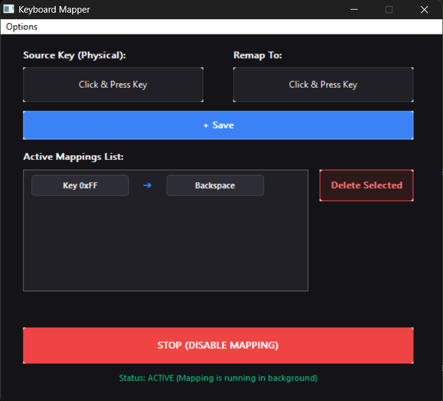

# Keyboard Mapper

A simple Windows desktop application for remapping keyboard keys.

## Features

- Remap one keyboard key to another key
- Global keyboard mapping using Windows Low-Level Keyboard Hook
- Enable / disable keyboard mapping
- Add and delete key mappings
- Save and load mapping presets
- Automatic configuration saving
- Windows startup option
- System tray support
- Dark mode and light mode
- English and Bahasa Indonesia support
- Single-instance application

## Screenshot

## Technologies

- C++
- Win32 API
- Windows Hooks
- Windows Registry
- Windows System Tray
- Common Controls
- Visual Studio

## How It Works

The application captures keyboard input using `WH_KEYBOARD_LL`.

Example:

`A → B`

When mapping is active, pressing `A` will produce `B`.

## Build

1. Open the project using Visual Studio.
2. Make sure the project is configured for Windows desktop development.
3. Build the project using `Build > Build Solution`.
4. Run the generated `.exe`.
5. enjoy 

## Configuration

Mapping presets use the `.kmp` file format.

The application automatically saves its default mappings to:

`default_mappings.kmp`

